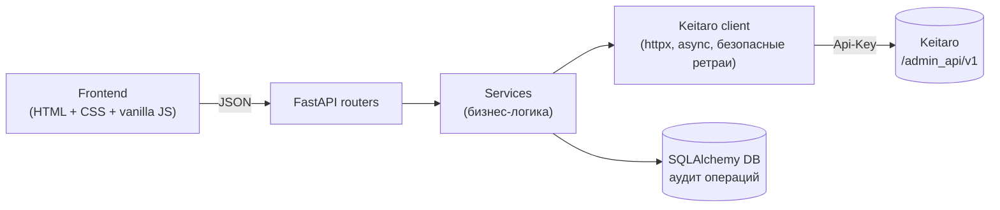

# Архитектура: Adrobot — обёртка над Keitaro

> 🇺🇿 O'zbekcha: [ARCHITECTURE.uz.md](ARCHITECTURE.uz.md) · Статус: **реализовано, покрыто тестами (48) и прогоняется в CI**.

## 1. Цель и границы

Сервис — тонкая обёртка над Admin API Keitaro (v1). Две функции:

1. **Создатель кампаний**: вход — `name`, `geo` (код страны), `offer_id`. Выход — кампания в Keitaro с двумя потоками, настроенными доменом, группой и источником.
2. **Редактор кампании**: просмотр потоков/офферов выбранной кампании, добавление и удаление офферов, корректные доли (%) и статистика.

Вне границ: авторизация пользователей, собственное хранение офферов/статистики, рекламные интеграции.

## 2. Принципы

| Принцип | Следствие |
|---|---|
| **Keitaro — единственный источник истины** | Мы не дублируем кампании/офферы/статистику в своей БД. Всё читаем из API. |
| **Своя БД — только аудит** | Таблица истории операций (кто/что/когда/результат) для отладки и отчёта. |
| **Тонкие слои** | `router → service → keitaro client`. Бизнес-логика только в `services`. |
| **Секреты вне репозитория** | Ключ и URL — только из `.env`; в git лежит `.env.example`. |
| **Безопасность тестовых данных** | Любая кампания обязана начинаться с префикса `test_<фамилия>_` (проверка на бэкенде). |
| **Мутации не повторяются вслепую** | POST-создания не ретраятся; неоднозначный исход явно сообщается (см. §5). |
| **Не ломать чужую конфигурацию** | PUT потока строится от исходного представления; меняем только офферы. |
| **Частичные сбои обрабатываются** | Если создание потока упало — откатываем (архивируем) созданную кампанию. |

## 3. Общая схема



## 4. Структура проекта

```
adrobot-keitaro/
├── app/
│   ├── main.py              # FastAPI, lifespan, middleware X-Request-ID, статика
│   ├── config.py            # pydantic-settings, чтение .env
│   ├── db.py                # engine, SessionLocal, Base
│   ├── models.py            # ORM: OperationLog
│   ├── schemas.py           # Pydantic-схемы запросов/ответов
│   ├── errors.py            # доменные ошибки + безопасные обработчики
│   ├── countries.py         # ISO-3166 коды стран (113)
│   ├── keitaro/
│   │   ├── client.py        # HTTP-клиент: таймауты, безопасные ретраи, ошибки
│   │   └── models.py        # DTO ответов Keitaro (+ raw для PUT без потерь)
│   ├── services/
│   │   ├── reference.py     # домен/группа/источник по имени → ID (кэш)
│   │   ├── offers.py        # поиск офферов для автокомплита (TTL-кэш)
│   │   ├── report.py        # статистика из POST /report/build
│   │   ├── audit.py         # запись в operation_log
│   │   ├── campaign_creator.py
│   │   ├── campaign_editor.py
│   │   └── views.py         # DTO Keitaro → схемы ответа
│   └── routers/
│       ├── meta.py          # /health, /health/live, /health/ready, /api/meta
│       ├── offers.py
│       ├── campaigns.py
│       └── operations.py
├── alembic/                 # миграции (alembic upgrade head)
├── static/                  # index.html, styles.css, premium.css, fx.js, app.js, favicon.svg
├── tests/                   # pytest + respx (51 тест)
├── scripts/                 # dev.ps1, check.ps1, mock_keitaro.py
├── .github/workflows/ci.yml # lint, tests (3.11–3.13), миграции, фронтенд
├── pyproject.toml           # ruff + pytest конфигурация
├── requirements.txt / requirements-dev.txt
├── docs/
├── .env.example
└── README.md / README.uz.md
```

## 5. Слои

- **Router** — валидация входа (Pydantic), вызов сервиса, маппинг ошибок в HTTP-коды. Логики нет.
- **Service** — сценарии. Знает *что* делать, не знает *как* ходить по HTTP.
- **Keitaro client** — единственное место, где есть URL, заголовок `Api-Key`, таймауты (15 с) и политика повторов.
- **DB** — SQLAlchemy 2.x + Alembic. По умолчанию SQLite, через `DATABASE_URL` — PostgreSQL.

### Политика повторов (mutation safety)

| Операция | Повторяется? | Неоднозначный исход |
|---|---|---|
| GET (все чтения) | да, `KEITARO_RETRIES` при сетевых сбоях/5xx/429 | — |
| PUT /streams/{id} (полная замена) | да | — |
| DELETE /campaigns/{id} (архив) | да | — |
| POST /report/build (read-only по сути) | да (`safe_to_retry=True`) | — |
| **POST /campaigns** | **нет, никогда** | `keitaro_ambiguous` + сверка в админке |
| **POST /streams** | **нет, никогда** | `keitaro_ambiguous` + сверка в админке |

Idempotency-ключи Keitaro официально не поддерживает, поэтому для мутаций используется стратегия «сверка» (reconciliation): при таймауте/5xx после отправки POST ресурс мог быть создан, повторять нельзя — сервис фиксирует это в аудите и возвращает `keitaro_ambiguous`. В сценарии создания при сбое потоков уже созданная кампания архивируется (откат безопасен и при неоднозначном исходе).

### Сохранность конфигурации при редактировании

`PUT /streams/{id}` — полная замена представления (так устроен Admin API v1). Чтобы не потерять поля, которыми приложение не управляет (triggers, comments, filter_or, chance, action_options, landings, collect_clicks), тело PUT строится от **исходного payload**, полученного из GET, и меняются только привязки офферов (`Stream.raw` в DTO). Регрессионный тест: `test_update_preserves_unmanaged_stream_fields`.

## 6. Контракт Keitaro Admin API v1 (сверен)

Контракт сверен с официальной документацией Admin API v1 ([gist asabirov](https://gist.github.com/asabirov/3cd29f43de41bd76ab93de073a7883a9), asabirov — разработчик Keitaro) и закреплён в `app/keitaro/client.py`.

| Что нужно | Вызов |
|---|---|
| Домен по имени | `GET /domains` |
| Группа по имени | `GET /groups?type=campaigns` |
| Источник по имени | `GET /traffic_sources` |
| Оффер по ID | `GET /offers/{id}` |
| Список офферов (автокомплит) | `GET /offers` (фильтр по имени/ID на нашей стороне, кэш 30 с) |
| Создать кампанию | `POST /campaigns` — `name`, `alias` (генерируем), `type`, `state`, `domain_id`, `group_id`, `traffic_source_id`, `cost_type`, `cost_value`, `cost_currency`, `cost_auto` |
| Создать поток | `POST /streams` — `campaign_id`, `type: regular`, `name`, `position`, `state`, `schema`, `action_type`, `action_payload`, `filters`, `offers` |
| Потоки кампании | `GET /campaigns/{id}/streams` |
| Поток по ID | `GET /streams/{id}` |
| Обновить поток | `PUT /streams/{id}` (полное тело от GET + новые привязки офферов) |
| Архив кампании (откат) | `DELETE /campaigns/{id}` |
| Статистика | `POST /report/build` — `range {interval, timezone}`, `grouping [stream_id, offer_id]`, `metrics [clicks, stream_unique_clicks, bots, conversions, cr]`, `filters [campaign_id EQUALS …]` |

Авторизация: заголовок `Api-Key: <ключ>`.

### Поток-редирект (гео → Google)

`schema: "redirect"`, `action_type: "http"`, `action_payload: <REDIRECT_URL>`, фильтр (имена проверены на реальном Keitaro; настраиваются через `COUNTRY_FILTER_NAME`/`COUNTRY_FILTER_MODE`):

```json
{"filters": [{"name": "country", "mode": "accept", "payload": ["UZ"]}]}
```

### Поток офферов (catch-all)

На реальном Keitaro офферные потоки — это **`schema: "landings"`** («Landing pages & offers») с массивом `offers`; `action_type` обязателен даже здесь:

```json
{"schema": "landings", "action_type": "http", "offers": [{"offer_id": 12, "share": 100}]}
```

## 7. Сценарий A — создание кампании

Вход: `{ name, geo, offer_id }`.

1. Валидация: `name` начинается с `CAMPAIGN_PREFIX`; `geo` — 2 буквы ISO-3166 (справочник в `app/countries.py`); `offer_id` — целое > 0.
2. Проверка, что оффер существует (`GET /offers/{id}`), иначе `404`.
3. `reference` резолвит `DEFAULT_DOMAIN`, `DEFAULT_GROUP`, `DEFAULT_SOURCE` в ID (кэш на время жизни процесса).
4. `POST /campaigns` (alias: транслитерация + случайный суффикс) → `campaign_id`. Если исход неоднозначен (таймаут/5xx) — ID неизвестен, откат невозможен: аудит-запись `error` + `keitaro_ambiguous` клиенту.
5. **Поток 1 (позиция 1):** фильтр «страна — принимать `geo`», действие — редирект на `REDIRECT_URL`.
6. **Поток 2 (позиция 2):** без фильтров, схема «офферы», один оффер с долей 100%.
7. Запись в `operation_log` (успех/ошибка).
8. **Откат:** если шаги 5–6 упали — `DELETE /campaigns/{id}` (архивирование) и запись ошибки в лог.

Порядок потоков важен: Keitaro проверяет их сверху вниз, поэтому «гео-поток» идёт первым, «catch-all» — вторым (ротация «По позиции», `CAMPAIGN_TYPE=position`).

## 8. Сценарий B — редактор кампании

**Чтение:** `GET /api/campaigns/{id}` → кампания + её потоки + офферы потока (название, доля %, клики/уники/конверсии из `POST /report/build`).

**Добавить оффер** (`POST /api/campaigns/{id}/streams/{stream_id}/offers {offer_id}`):
1. Получить поток, проверить схему (`offers`) и что оффера там ещё нет (`409`).
2. Добавить и **пересчитать доли**: сумма = 100%, поровну, остаток от деления — первым офферам (`distribute_shares`).
3. `PUT /streams/{id}` от исходного payload (см. §5); вернуть обновлённое состояние.

**Удалить оффер** (`DELETE …/offers/{offer_id}`):
1. Удалить, **перераспределить доли** между оставшимися (сумма = 100%).
2. Нельзя удалить последний оффер в потоке с схемой «офферы» → `409`.

«Верные цифры»: (а) доли всегда в сумме дают 100% (тестируется, в т.ч. при повторных операциях); (б) клики/уники/боты/конверсии/CR — из `report/build` (группировка по потоку и офферу); (в) период и таймзона — `REPORT_INTERVAL`, `REPORT_TIMEZONE`.

## 9. API сервиса

| Метод | Путь | Назначение |
|---|---|---|
| GET | `/health` | сводный статус (всегда 200; `keitaro`, `db`) |
| GET | `/health/live` | liveness: процесс жив (200) |
| GET | `/health/ready` | readiness: 200/503 по БД и Keitaro |
| GET | `/api/meta` | домен/группа/источник/префикс |
| GET | `/api/offers?q=` | автокомплит офферов |
| POST | `/api/campaigns` | создать кампанию |
| GET | `/api/campaigns?prefix=&q=` | список кампаний (по умолчанию — наши `test_…`) |
| GET | `/api/campaigns/{id}` | кампания, потоки, офферы, статистика |
| POST | `/api/campaigns/{id}/streams/{sid}/offers` | добавить оффер |
| DELETE | `/api/campaigns/{id}/streams/{sid}/offers/{oid}` | удалить оффер |
| GET | `/api/operations?limit=` | история операций (аудит) |

Единый формат ошибки: `{ "error": { "code": "...", "message": "..." } }`; каждый ответ несёт `X-Request-ID` (корреляция с логами; принимается и пробрасывается клиентский).

## 10. Модель данных (SQLAlchemy)

`operation_log`
| Поле | Тип | Описание |
|---|---|---|
| id | int PK | |
| created_at | datetime | UTC |
| action | str | `create_campaign` / `add_offer` / `remove_offer` |
| keitaro_campaign_id | int, null | |
| campaign_name | str, null | для удобства в истории |
| payload | JSON | входные параметры |
| status | str | `ok` / `error` |
| error | text, null | сообщение ошибки |

Миграции — Alembic (`alembic upgrade head`), ревизия `0001`; чистая установка проверяется в CI.

## 11. Ошибки и устойчивость

| Ситуация | Реакция |
|---|---|
| Keitaro недоступен (чтения, после ретраев) | `502 keitaro_unavailable` |
| Keitaro вернул 4xx/5xx | `502 keitaro_error`, внутренний текст — только в лог |
| Таймаут/5xx на POST-создании | **без повтора**: `502 keitaro_ambiguous` + сверка в админке |
| Оффер/кампания/поток не найдены | `404 not_found` |
| Неверное гео/имя/схема потока | `422 validation` |
| Конфликт (оффер уже есть / последний оффер) | `409 conflict` |
| Сбой отчёта `report/build` | статистика = нули, предупреждение в лог (редактор работает) |
| Сбой БД | `500 internal` с безопасным сообщением |
| Необработанное исключение | `500 internal` (безопасный текст), трейсбек в лог |

Раскрытие информации: сообщения 5xx-ошибок интеграции по умолчанию заменяются безопасной заглушкой (`AppError.public=False`); клиенту показываются только собственные, заранее составленные тексты. Проверяется тестом `test_keitaro_error_details_not_leaked`.

## 12. Frontend

Одна страница (HTML + vanilla JS, без сборки), раздаётся FastAPI из `static/`. **Premium pixel-terminal тема**: boot-экран (`fx.js`: пиксельная загрузка с dissolve/scramble/confetti, состояние Keitaro читается из health-бейджа, повторные загрузки — короткая последовательность, `prefers-reduced-motion` пропускает анимации), CRT-оверлей, tab-ink, анимация счётчиков. Три вкладки, **два языка — RU/UZ** (переключатель в шапке, выбор хранится в `localStorage`, весь интерфейс и названия стран локализованы; серверные сообщения об ошибках — на русском, см. §16):

- **«Новая кампания»** — Name (проверка префикса), Geo (выбор ISO-кода + свободный ввод, поиск по коду и названию на трёх языках), Offer (автокомплит с debounce 300 мс), Create; после создания — карточка кампании с двумя потоками, кнопками «Перейти в редактор» и «Keitaro» (открывает админку из `meta.admin_url`).
- **«Редактор кампаний»** — выбор кампании (поиск + кнопка обновления списка) → карточка (домен/группа/источник, тизеры статистики, «Keitaro») → карточки потоков: фильтры-чипы, таблица офферов с долями (прогресс-бары), статистикой и копированием ID оффера; добавление (автокомплит) и удаление (с подтверждением, последний — заблокирован); тосты ошибок, включая `keitaro_ambiguous`.
- **«История операций»** — таблица аудита из `operation_log`.

Ошибки сети и сервера обрабатываются единообразно (хелпер `api()` + тосты; известные коды ошибок имеют локализованные тексты); UI не падает при недоступном `/api/meta` (баннер + отключение создателя).

## 13. Тестирование

- `pytest` + `respx` (мок Keitaro): **51 тест**.
- Покрытие: создание (happy path, валидация, откат, неоднозначный исход POST), редактор (доли, конфликты, сохранность чужой конфигурации потока, деградация статистики, повторные операции), клиент Keitaro (ретраи идемпотентных, отсутствие ретраев мутаций, таймауты, 4xx/401), health (live/ready, `503` при падении зависимости), аудит (в т.ч. сбой БД → безопасный 500), корреляционные ID, отсутствие утечек.
- Ручной smoke-тест на реальном Keitaro с префиксом `test_<фамилия>_`.
- CI ([.github/workflows/ci.yml](.github/workflows/ci.yml)): ruff lint + format, pytest на Python 3.11–3.13, `alembic upgrade head` на чистой базе, `node --check` для фронтенда.

## 14. Конфигурация (`.env`)

См. `.env.example`: `KEITARO_BASE_URL`, `KEITARO_API_KEY`, `KEITARO_TIMEOUT`, `KEITARO_RETRIES`, `CAMPAIGN_PREFIX`, `CAMPAIGN_TYPE`, `DEFAULT_DOMAIN`, `DEFAULT_GROUP`, `DEFAULT_SOURCE`, `REDIRECT_URL`, `REPORT_INTERVAL`, `REPORT_TIMEZONE`, `DATABASE_URL`, `OFFERS_CACHE_TTL`.

## 15. Статус

| Этап | Статус |
|---|---|
| Сверка API по документации | ✅ контракт закреплён в `app/keitaro/client.py` |
| Скелет, config, Keitaro client | ✅ |
| Создатель кампаний + откат + тесты | ✅ |
| Редактор: чтение, add/remove, доли, статистика | ✅ |
| Mutation safety и сохранность конфигурации | ✅ (см. §5, регрессионные тесты) |
| Observability: live/ready, X-Request-ID | ✅ |
| Безопасность: нет утечек, нет секретов в git | ✅ |
| Frontend, SQLAlchemy + Alembic, обработка ошибок | ✅ |
| Premium pixel-terminal UI (boot-экран, эффекты) | ✅ |
| Проверка на реальном Keitaro (создание кампании) | ✅ |
| Lint (ruff), CI, pre-commit | ✅ |
| README (RU/UZ), демо-режим, скринкаст | ✅ |

## 16. Решённые вопросы

1. **Доли при добавлении/удалении** — после любого изменения сумма = 100%, поровну, остаток — первым офферам.
2. **Точные имена полей Keitaro API** — закреплены в §6 и в клиенте.
3. **Откат** — кампания архивируется через `DELETE /campaigns/{id}`; при неоднозначном исходе `POST /campaigns` откат невозможен (ID неизвестен) — фиксируется в аудите и сообщается клиенту.
4. **Повторы мутаций** — запрещены, неоднозначный исход выделен в отдельный код `keitaro_ambiguous`.
5. **Потеря конфигурации потока при PUT** — исключена за счёт отправки исходного payload (см. §5).

> Проверено на реальном Keitaro (tlgk.host): фильтр страны — `name="country", mode="accept"`; офферный поток — `schema="landings"` + обязательный `action_type="http"`; `domain_id` в `POST /campaigns` поддерживается; имя архивной кампании повторно использовать нельзя (сервис возвращает `409` с подсказкой). Все переключатели — в `app/services/campaign_creator.py` и `.env` (`COUNTRY_FILTER_*`).
