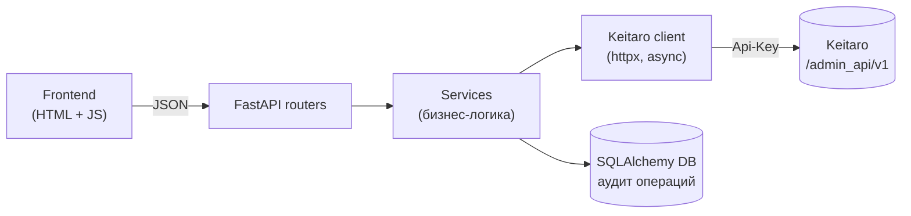

# Архитектура: Adrobot — обёртка над Keitaro

> 🇺🇿 O'zbekcha: [ARCHITECTURE.uz.md](ARCHITECTURE.uz.md)

## 1. Цель и границы

Сервис — тонкая обёртка над Admin API Keitaro (v1). Две функции:

1. **Создатель кампаний**: вход — `name`, `geo` (код страны), `offer_id`. Выход — кампания в Keitaro с двумя потоками, настроенными доменом, группой и источником.
2. **Редактор кампании**: просмотр потоков/офферов выбранной кампании, добавление и удаление офферов, корректные доли (%) и статистика.

Вне границ: авторизация пользователей, собственное хранение офферов/статистики, рекламные интеграции.

## 2. Принципы

| Принцип | Следствие |
|---|---|
| **Keitaro — единственный источник истины** | Мы не дублируем кампании/офферы/статистику в своей БД. Всё читаем из API. |
| **Своя БД — только аудит** | Таблица истории операций (кто/что/когда/результат) для отладки и отчёта. |
| **Тонкие слои** | `router → service → keitaro client`. Бизнес-логика только в `services`. |
| **Секреты вне репозитория** | Ключ и URL — только из `.env`; в git лежит `.env.example`. |
| **Безопасность тестовых данных** | Любая кампания обязана начинаться с префикса `test_<фамилия>_` (проверка на бэкенде). |
| **Частичные сбои обрабатываются** | Если создание потока упало — откатываем (удаляем) созданную кампанию. |

## 3. Общая схема



## 4. Структура проекта

```
adrobot-keitaro/
├── app/
│   ├── main.py              # создание FastAPI, подключение роутеров и статики
│   ├── config.py            # pydantic-settings, чтение .env
│   ├── db.py                # engine, SessionLocal, Base
│   ├── models.py            # ORM: OperationLog
│   ├── schemas.py           # Pydantic-схемы запросов/ответов
│   ├── errors.py            # доменные исключения + обработчики
│   ├── keitaro/
│   │   ├── client.py        # HTTP-клиент: таймауты, ретраи, обработка ошибок
│   │   └── models.py        # типизированные DTO ответов Keitaro
│   ├── services/
│   │   ├── reference.py     # домен/группа/источник по имени → ID (с кэшем)
│   │   ├── campaign_creator.py
│   │   └── campaign_editor.py
│   └── routers/
│       ├── meta.py
│       ├── offers.py
│       └── campaigns.py
├── alembic/                 # миграции
├── static/                  # index.html, app.js, styles.css
├── tests/                   # pytest + respx (мок Keitaro)
├── docs/
├── scripts/init_repo.ps1
├── .env.example
└── README.md
```

## 5. Слои

- **Router** — валидация входа (Pydantic), вызов сервиса, маппинг ошибок в HTTP-коды. Логики нет.
- **Service** — сценарии. Знает *что* делать, не знает *как* ходить по HTTP.
- **Keitaro client** — единственное место, где есть URL, заголовок `Api-Key`, таймауты (напр. 10 с), ретраи на 5xx/сетевые сбои (2–3 попытки), преобразование ответов в DTO.
- **DB** — SQLAlchemy 2.x + Alembic. По умолчанию SQLite, через `DATABASE_URL` можно подключить PostgreSQL.

## 6. Сопоставление с Keitaro Admin API

> ⚠️ Названия эндпоинтов и полей ниже — по моей памяти о Keitaro Admin API v1. **Сверить с документацией в админке** (Профиль → API ключи → Документация) до начала кодинга; отличия исправить в этой таблице и в `keitaro/client.py`.

| Что нужно | Вероятный вызов |
|---|---|
| Домен по имени | `GET /domains` |
| Группа по имени | `GET /groups?type=campaigns` |
| Источник по имени | `GET /traffic_sources` |
| Поиск офферов (автокомплит) | `GET /offers` (фильтр по имени на нашей стороне или в параметрах) |
| Создать кампанию | `POST /campaigns` (`name`, `type`, `domain_id`, `group_id`, `traffic_source_id`, `cost_type`, …) |
| Создать поток | `POST /streams` (`campaign_id`, `type`, `schema`, `action_type`, `action_payload`, `filters`, `offers`) |
| Потоки кампании | `GET /campaigns/{id}/streams` |
| Обновить поток | `PUT /streams/{id}` |
| Статистика | `POST /report/build` |

Авторизация: заголовок `Api-Key: <ключ>`.

## 7. Сценарий A — создание кампании

Вход: `{ name, geo, offer_id }`.

1. Валидация: `name` начинается с `CAMPAIGN_PREFIX`; `geo` — 2 буквы ISO-3166 (в верхний регистр); `offer_id` — целое > 0.
2. `reference` резолвит `DEFAULT_DOMAIN`, `DEFAULT_GROUP`, `DEFAULT_SOURCE` в ID (кэш на время жизни процесса).
3. Проверка, что оффер существует (`GET /offers`), иначе `404`.
4. `POST /campaigns` → получаем `campaign_id`.
5. **Поток 1 (позиция 1):** фильтр «страна — принимать `geo`», действие — редирект на `REDIRECT_URL` (google.com).
6. **Поток 2 (позиция 2):** без фильтров, схема «офферы», один оффер с долей 100%.
7. Запись в `operation_log` (успех/ошибка).
8. **Откат:** если шаги 5–6 упали — `DELETE` кампании (или архивирование) и запись ошибки в лог.

Порядок потоков важен: Keitaro проверяет их сверху вниз, поэтому «гео-поток» должен идти первым, а «catch-all» — вторым (в ротации «По позиции»).

## 8. Сценарий B — редактор кампании

**Чтение:** `GET /api/campaigns/{id}` → кампания + её потоки + офферы потока (название, доля %, клики/конверсии из отчёта).

**Добавить оффер** (`POST /api/campaigns/{id}/streams/{stream_id}/offers {offer_id}`):
1. Получить поток, проверить, что оффера там ещё нет.
2. Добавить, **пересчитать доли** так, чтобы сумма = 100% (по умолчанию — поровну; остаток от округления отдаём первому офферу).
3. `PUT /streams/{id}` целиком; вернуть обновлённое состояние.

**Удалить оффер** (`DELETE …/offers/{offer_id}`):
1. Удалить, **перераспределить доли** между оставшимися (сумма = 100%).
2. Нельзя удалить последний оффер в потоке с схемой «офферы» → `409` с понятным сообщением.

> «Верные цифры» мы трактуем как: (а) доли офферов всегда в сумме дают 100%; (б) клики/уники/боты берутся напрямую из Keitaro. **Уточнить по видео из ТЗ** (https://youtu.be/jNloscEWCjA).

## 9. API сервиса

| Метод | Путь | Назначение |
|---|---|---|
| GET | `/api/meta` | домен/группа/источник/префикс (для отображения в UI) |
| GET | `/api/offers?q=` | автокомплит офферов |
| POST | `/api/campaigns` | создать кампанию |
| GET | `/api/campaigns?prefix=` | список кампаний (по умолчанию — наши `test_…`) |
| GET | `/api/campaigns/{id}` | кампания, потоки, офферы, статистика |
| POST | `/api/campaigns/{id}/streams/{sid}/offers` | добавить оффер |
| DELETE | `/api/campaigns/{id}/streams/{sid}/offers/{oid}` | удалить оффер |
| GET | `/health` | проверка живости |

Единый формат ошибки: `{ "error": { "code": "...", "message": "..." } }`.

## 10. Модель данных (SQLAlchemy)

`operation_log`
| Поле | Тип | Описание |
|---|---|---|
| id | int PK | |
| created_at | datetime | UTC |
| action | str | `create_campaign` / `add_offer` / `remove_offer` |
| keitaro_campaign_id | int, null | |
| payload | JSON | входные параметры |
| status | str | `ok` / `error` |
| error | text, null | сообщение ошибки |

Миграции — Alembic (`alembic upgrade head`).

## 11. Ошибки и устойчивость

| Ситуация | Реакция |
|---|---|
| Keitaro недоступен / таймаут | ретрай, затем `502` |
| Неверный ключ (401/403) | `502` + явное сообщение в логе (не в ответе клиенту) |
| Оффер не найден | `404` |
| Неверное гео/имя | `422` |
| Конфликт (оффер уже есть / последний оффер) | `409` |

## 12. Frontend

Одна страница (HTML + vanilla JS, без сборки), раздаётся FastAPI из `static/`.
- Вкладка **«Новая кампания»** — по макету из ТЗ: Name, Geo, Offer (автокомплит с debounce), кнопка Create.
- Вкладка **«Редактор»** — выбор кампании → потоки → офферы с долями и статистикой, кнопки «Добавить»/«Удалить», обновление без перезагрузки.

## 13. Тестирование

- `pytest` + `respx` (мок Keitaro). Покрываем: создание (в т.ч. откат), добавление/удаление с пересчётом долей, валидацию.
- Один ручной smoke-тест на реальном Keitaro с префиксом `test_<фамилия>_`.

## 14. Конфигурация (`.env`)

См. `.env.example`: `KEITARO_BASE_URL`, `KEITARO_API_KEY`, `CAMPAIGN_PREFIX`, `DEFAULT_DOMAIN`, `DEFAULT_GROUP`, `DEFAULT_SOURCE`, `REDIRECT_URL`, `DATABASE_URL`.

## 15. План (5 дней)

| День | Работа |
|---|---|
| 1 | Сверка API по документации, скелет, config, Keitaro client |
| 2 | Создатель кампаний + откат + тесты |
| 3 | Редактор: чтение, add/remove, пересчёт долей, статистика |
| 4 | Frontend, SQLAlchemy + Alembic, обработка ошибок |
| 5 | README, чистка, скринкаст, форма сдачи |

## 16. Открытые вопросы

1. Видео из ТЗ: как именно ведут себя доли при добавлении/удалении оффера и какие цифры показаны.
2. Точные имена полей Keitaro API (раздел 6).
3. Откат: удалять кампанию или архивировать — зависит от прав ключа.
