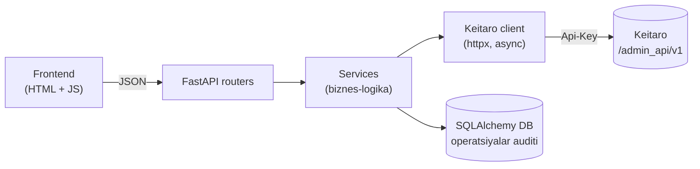

# Arxitektura: Adrobot — Keitaro ustidan o'ram (wrapper)

> 🇷🇺 По-русски: [ARCHITECTURE.ru.md](ARCHITECTURE.ru.md)

## 1. Maqsad va chegaralar

Xizmat — Keitaro Admin API (v1) ustidagi yupqa o'ram. Ikki vazifa:

1. **Kampaniya yaratuvchi**: kirish — `name`, `geo` (davlat kodi), `offer_id`. Natija — Keitaro'da ikki oqimli kampaniya, domen, guruh va manba sozlangan.
2. **Kampaniya muharriri**: tanlangan kampaniyaning oqim/offerlarini ko'rish, offer qo'shish va o'chirish, to'g'ri ulushlar (%) va statistika.

Chegaradan tashqari: foydalanuvchi avtorizatsiyasi, offer/statistikani o'zimizda saqlash, reklama integratsiyalari.

## 2. Tamoyillar

| Tamoyil | Oqibat |
|---|---|
| **Keitaro — yagona haqiqat manbai** | Kampaniya/offer/statistikani o'z DB'mizda takrorlamaymiz. Hammasini API'dan o'qiymiz. |
| **O'z DB'miz — faqat audit** | Operatsiyalar tarixi jadvali (kim/nima/qachon/natija): nosozlikni topish va hisobot uchun. |
| **Yupqa qatlamlar** | `router → service → keitaro client`. Biznes-logika faqat `services`'da. |
| **Sirlar repodan tashqarida** | Kalit va URL faqat `.env`'dan; gitda `.env.example` turadi. |
| **Test ma'lumotlari xavfsizligi** | Har bir kampaniya `test_<familiya>_` prefiksi bilan boshlanishi shart (backend tekshiradi). |
| **Qisman xatolar hisobga olinadi** | Oqim yaratish yiqilsa, yaratilgan kampaniyani qaytarib o'chiramiz (rollback). |

## 3. Umumiy sxema



## 4. Loyiha tuzilmasi

```
adrobot-keitaro/
├── app/
│   ├── main.py              # FastAPI yaratish, routerlar va static ulash
│   ├── config.py            # pydantic-settings, .env o'qish
│   ├── db.py                # engine, SessionLocal, Base
│   ├── models.py            # ORM: OperationLog
│   ├── schemas.py           # so'rov/javob Pydantic sxemalari
│   ├── errors.py            # domen xatolari + handlerlar
│   ├── keitaro/
│   │   ├── client.py        # HTTP-klient: timeout, retry, xatolarni qayta ishlash
│   │   └── models.py        # Keitaro javoblari uchun DTO
│   ├── services/
│   │   ├── reference.py     # domen/guruh/manba nomi → ID (kesh bilan)
│   │   ├── campaign_creator.py
│   │   └── campaign_editor.py
│   └── routers/
│       ├── meta.py
│       ├── offers.py
│       └── campaigns.py
├── alembic/                 # migratsiyalar
├── static/                  # index.html, app.js, styles.css
├── tests/                   # pytest + respx (Keitaro mock)
├── docs/
├── scripts/init_repo.ps1
├── .env.example
└── README.md
```

## 5. Qatlamlar

- **Router** — kirishni tekshirish (Pydantic), servisni chaqirish, xatolarni HTTP kodlarga o'tkazish. Logika yo'q.
- **Service** — stsenariylar. *Nima* qilishni biladi, HTTP orqali *qanday* borishni bilmaydi.
- **Keitaro client** — URL, `Api-Key` sarlavhasi, timeout (masalan 10 s), 5xx/tarmoq xatolarida retry (2–3 urinish), javoblarni DTO'ga o'girish shu yerda yagona.
- **DB** — SQLAlchemy 2.x + Alembic. Standart SQLite, `DATABASE_URL` orqali PostgreSQL ulash mumkin.

## 6. Keitaro Admin API bilan moslik

> ⚠️ Quyidagi endpoint va maydon nomlari Keitaro Admin API v1 haqidagi xotiramdan. Kodlashdan oldin **admindagi hujjat bilan solishtirish kerak** (Profil → API kalitlar → Hujjat); farq bo'lsa shu jadval va `keitaro/client.py`'ni tuzatamiz.

| Nima kerak | Ehtimoliy chaqiruv |
|---|---|
| Domen (nomi bo'yicha) | `GET /domains` |
| Guruh (nomi bo'yicha) | `GET /groups?type=campaigns` |
| Manba (nomi bo'yicha) | `GET /traffic_sources` |
| Offer qidiruvi (autocomplete) | `GET /offers` (nom bo'yicha filtr o'z tomonimizda yoki parametrda) |
| Kampaniya yaratish | `POST /campaigns` (`name`, `type`, `domain_id`, `group_id`, `traffic_source_id`, `cost_type`, …) |
| Oqim yaratish | `POST /streams` (`campaign_id`, `type`, `schema`, `action_type`, `action_payload`, `filters`, `offers`) |
| Kampaniya oqimlari | `GET /campaigns/{id}/streams` |
| Oqimni yangilash | `PUT /streams/{id}` |
| Statistika | `POST /report/build` |

Avtorizatsiya: `Api-Key: <kalit>` sarlavhasi.

## 7. A stsenariy — kampaniya yaratish

Kirish: `{ name, geo, offer_id }`.

1. Validatsiya: `name` `CAMPAIGN_PREFIX` bilan boshlanadi; `geo` — ISO-3166 bo'yicha 2 harf (katta harfga o'giriladi); `offer_id` — butun son > 0.
2. `reference` `DEFAULT_DOMAIN`, `DEFAULT_GROUP`, `DEFAULT_SOURCE`'ni ID'ga aylantiradi (jarayon ishlaguncha kesh).
3. Offer mavjudligini tekshirish (`GET /offers`), yo'q bo'lsa `404`.
4. `POST /campaigns` → `campaign_id`.
5. **1-oqim (pozitsiya 1):** filtr «davlat — `geo`ni qabul qilish», amal — `REDIRECT_URL` (google.com)ga redirect.
6. **2-oqim (pozitsiya 2):** filtrsiz, «offerlar» sxemasi, bitta offer, ulushi 100%.
7. `operation_log`ga yozuv (muvaffaqiyat/xato).
8. **Rollback:** 5–6-qadam yiqilsa — kampaniya `DELETE` qilinadi (yoki arxivlanadi), xato logga yoziladi.

Oqimlar tartibi muhim: Keitaro ularni yuqoridan pastga tekshiradi, shuning uchun «geo-oqim» birinchi, «catch-all» ikkinchi bo'lishi kerak («Pozitsiya bo'yicha» rotatsiyada).

## 8. B stsenariy — kampaniya muharriri

**O'qish:** `GET /api/campaigns/{id}` → kampaniya + oqimlar + oqim offerlari (nomi, ulushi %, hisobotdan klik/konversiyalar).

**Offer qo'shish** (`POST /api/campaigns/{id}/streams/{stream_id}/offers {offer_id}`):
1. Oqimni olish, offer u yerda yo'qligini tekshirish.
2. Qo'shish va **ulushlarni qayta hisoblash**: yig'indi = 100% (standart — teng taqsimlash; yaxlitlash qoldig'i birinchi offerga).
3. `PUT /streams/{id}` to'liq; yangilangan holatni qaytarish.

**Offer o'chirish** (`DELETE …/offers/{offer_id}`):
1. O'chirish, qolganlar orasida ulushlarni **qayta taqsimlash** (yig'indi = 100%).
2. «Offerlar» sxemali oqimdagi oxirgi offerni o'chirib bo'lmaydi → tushunarli xabar bilan `409`.

> «To'g'ri raqamlar»ni biz shunday tushunamiz: (a) offer ulushlari doim 100% beradi; (b) klik/unik/bot bevosita Keitaro'dan olinadi. **ТЗ'dagi videodan aniqlashtirish kerak** (https://youtu.be/jNloscEWCjA).

## 9. Xizmat API'si

| Metod | Yo'l | Vazifa |
|---|---|---|
| GET | `/api/meta` | domen/guruh/manba/prefiks (UI'da ko'rsatish uchun) |
| GET | `/api/offers?q=` | offerlar autocomplete |
| POST | `/api/campaigns` | kampaniya yaratish |
| GET | `/api/campaigns?prefix=` | kampaniyalar ro'yxati (standart — bizning `test_…`) |
| GET | `/api/campaigns/{id}` | kampaniya, oqimlar, offerlar, statistika |
| POST | `/api/campaigns/{id}/streams/{sid}/offers` | offer qo'shish |
| DELETE | `/api/campaigns/{id}/streams/{sid}/offers/{oid}` | offer o'chirish |
| GET | `/health` | tirikligini tekshirish |

Yagona xato formati: `{ "error": { "code": "...", "message": "..." } }`.

## 10. Ma'lumotlar modeli (SQLAlchemy)

`operation_log`
| Maydon | Tur | Tavsif |
|---|---|---|
| id | int PK | |
| created_at | datetime | UTC |
| action | str | `create_campaign` / `add_offer` / `remove_offer` |
| keitaro_campaign_id | int, null | |
| payload | JSON | kirish parametrlari |
| status | str | `ok` / `error` |
| error | text, null | xato matni |

Migratsiyalar — Alembic (`alembic upgrade head`).

## 11. Xatolar va chidamlilik

| Holat | Reaksiya |
|---|---|
| Keitaro ochilmayapti / timeout | retry, keyin `502` |
| Noto'g'ri kalit (401/403) | `502` + logda aniq xabar (mijozga emas) |
| Offer topilmadi | `404` |
| Noto'g'ri geo/nom | `422` |
| Ziddiyat (offer allaqachon bor / oxirgi offer) | `409` |

## 12. Frontend

Bitta sahifa (HTML + vanilla JS, build'siz), FastAPI `static/`dan beradi.
- **«Yangi kampaniya»** tabi — ТЗ'dagi maket bo'yicha: Name, Geo, Offer (debounce bilan autocomplete), Create tugmasi.
- **«Muharrir»** tabi — kampaniya tanlash → oqimlar → ulush va statistikali offerlar, «Qo'shish»/«O'chirish» tugmalari, sahifani qayta yuklamasdan yangilanish.

## 13. Test

- `pytest` + `respx` (Keitaro mock). Qamrov: yaratish (rollback bilan), qo'shish/o'chirish va ulushlarni qayta hisoblash, validatsiya.
- Haqiqiy Keitaro'da `test_<familiya>_` prefiksi bilan bitta qo'lda smoke-test.

## 14. Konfiguratsiya (`.env`)

`.env.example`ga qarang: `KEITARO_BASE_URL`, `KEITARO_API_KEY`, `CAMPAIGN_PREFIX`, `DEFAULT_DOMAIN`, `DEFAULT_GROUP`, `DEFAULT_SOURCE`, `REDIRECT_URL`, `DATABASE_URL`.

## 15. Reja (5 kun)

| Kun | Ish |
|---|---|
| 1 | API'ni hujjat bo'yicha solishtirish, skelet, config, Keitaro client |
| 2 | Kampaniya yaratuvchi + rollback + testlar |
| 3 | Muharrir: o'qish, add/remove, ulushlarni hisoblash, statistika |
| 4 | Frontend, SQLAlchemy + Alembic, xatolarni qayta ishlash |
| 5 | README, tozalash, skrinkast, topshirish formasi |

## 16. Ochiq savollar

1. ТЗ'dagi video: offer qo'shilganda/o'chirilganda ulushlar aynan qanday o'zgaradi va qanday raqamlar ko'rsatiladi.
2. Keitaro API maydonlarining aniq nomlari (6-bo'lim).
3. Rollback: kampaniyani o'chirish yoki arxivlash — kalit huquqlariga bog'liq.
