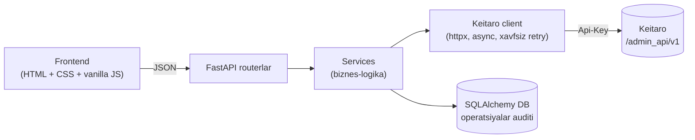

# Arxitektura: Adrobot — Keitaro ustidan o'ram (wrapper)

> 🇷🇺 По-русски: [ARCHITECTURE.ru.md](ARCHITECTURE.ru.md) · Holat: **amalga oshirilgan, testlar bilan qoplangan (48) va CI'da tekshiriladi**.

## 1. Maqsad va chegaralar

Xizmat — Keitaro Admin API (v1) ustidagi yupqa o'ram. Ikki vazifa:

1. **Kampaniya yaratuvchi**: kirish — `name`, `geo` (davlat kodi), `offer_id`. Natija — Keitaro'da ikki oqimli kampaniya, domen, guruh va manba sozlangan.
2. **Kampaniya muharriri**: tanlangan kampaniyaning oqim/offerlarini ko'rish, offer qo'shish va o'chirish, to'g'ri ulushlar (%) va statistika.

Chegaradan tashqari: foydalanuvchi avtorizatsiyasi, offer/statistikani o'zimizda saqlash, reklama integratsiyalari.

## 2. Tamoyillar

| Tamoyil | Oqibat |
|---|---|
| **Keitaro — yagona haqiqat manbai** | Kampaniya/offer/statistikani o'z DB'mizda takrorlamaymiz. Hammasini API'dan o'qiymiz. |
| **O'z DB'miz — faqat audit** | Operatsiyalar tarixi jadvali (kim/nima/qachon/natija): nosozlikni topish va hisobot uchun. |
| **Yupqa qatlamlar** | `router → service → keitaro client`. Biznes-logika faqat `services`'da. |
| **Sirlar repodan tashqarida** | Kalit va URL faqat `.env`'dan; gitda `.env.example` turadi. |
| **Test ma'lumotlari xavfsizligi** | Har bir kampaniya `test_<familiya>_` prefiksi bilan boshlanishi shart (backend tekshiradi). |
| **Mutatsiyalar ko'r-ko'rona takrorlanmaydi** | POST-yaratishlar retry qilinmaydi; noaniq natija ochiq aytiladi (§5). |
| **Boshqa konfiguratsiyani buzmaymiz** | Oqim PUT'i asl ko'rinishdan quriladi; faqat offerlar o'zgaradi. |
| **Qisman xatolar hisobga olinadi** | Oqim yaratish yiqilsa, yaratilgan kampaniyani qaytarib o'chiramiz (arxivlaymiz). |

## 3. Umumiy sxema



## 4. Loyiha tuzilmasi

```
adrobot-keitaro/
├── app/
│   ├── main.py              # FastAPI, lifespan, X-Request-ID middleware, statika
│   ├── config.py            # pydantic-settings, .env o'qish
│   ├── db.py                # engine, SessionLocal, Base
│   ├── models.py            # ORM: OperationLog
│   ├── schemas.py           # so'rov/javob Pydantic sxemalari
│   ├── errors.py            # domen xatolari + xavfsiz handlerlar
│   ├── countries.py         # ISO-3166 davlat kodlari (113)
│   ├── keitaro/
│   │   ├── client.py        # HTTP-klient: timeoutlar, xavfsiz retry, xatolar
│   │   └── models.py        # Keitaro javoblari DTO'lari (+ yo'qotishsiz PUT uchun raw)
│   ├── services/
│   │   ├── reference.py     # domen/guruh/manba nomi → ID (kesh)
│   │   ├── offers.py        # autocomplete uchun offerlar qidiruvi (TTL-kesh)
│   │   ├── report.py        # POST /report/build statistikasi
│   │   ├── audit.py         # operation_log'ga yozish
│   │   ├── campaign_creator.py
│   │   ├── campaign_editor.py
│   │   └── views.py         # Keitaro DTO → javob sxemasi
│   └── routers/
│       ├── meta.py          # /health, /health/live, /health/ready, /api/meta
│       ├── offers.py
│       ├── campaigns.py
│       └── operations.py
├── alembic/                 # migratsiyalar (alembic upgrade head)
├── static/                  # index.html, styles.css, app.js, favicon.svg
├── tests/                   # pytest + respx (48 test)
├── scripts/                 # dev.ps1, check.ps1, mock_keitaro.py
├── .github/workflows/ci.yml # lint, testlar (3.11–3.13), migratsiyalar, frontend
├── pyproject.toml           # ruff + pytest sozlamalari
├── requirements.txt / requirements-dev.txt
├── docs/
├── .env.example
└── README.md / README.uz.md
```

## 5. Qatlamlar

- **Router** — kirishni tekshirish (Pydantic), servisni chaqirish, xatolarni HTTP kodlarga o'tkazish. Logika yo'q.
- **Service** — stsenariylar. *Nima* qilishni biladi, HTTP orqali *qanday* borishni bilmaydi.
- **Keitaro client** — URL, `Api-Key` sarlavhasi, timeout (15 s) va retry siyosati shu yerda yagona.
- **DB** — SQLAlchemy 2.x + Alembic. Standart SQLite, `DATABASE_URL` orqali PostgreSQL.

### Retry siyosati (mutation safety)

| Operatsiya | Takrorlanadimi? | Noaniq natija |
|---|---|---|
| GET (barcha o'qishlar) | ha, tarmoq xatosi/5xx/429 da `KEITARO_RETRIES` marta | — |
| PUT /streams/{id} (to'liq almashtirish) | ha | — |
| DELETE /campaigns/{id} (arxiv) | ha | — |
| POST /report/build (aslida read-only) | ha (`safe_to_retry=True`) | — |
| **POST /campaigns** | **yo'q, hech qachon** | `keitaro_ambiguous` + admin bilan solishtirish |
| **POST /streams** | **yo'q, hech qachon** | `keitaro_ambiguous` + admin bilan solishtirish |

Keitaro idempotency-kalitlarni rasman qo'llab-quvvatlamaydi, shuning uchun mutatsiyalar uchun «solishtirish» (reconciliation) strategiyasi ishlatiladi: POST'dan keyin timeout/5xx bo'lsa resurs yaratilgan bo'lishi mumkin, takrorlash taqiqlanadi — xizmat buni auditga yozadi va `keitaro_ambiguous` qaytaradi. Yaratish stsenariysida oqimlar yiqilsa, yaratilgan kampaniya arxivlanadi (rollback noaniq natijada ham xavfsiz).

### Tahrirlashda konfiguratsiya saqlanishi

`PUT /streams/{id}` — ko'rinishni to'liq almashtirish (Admin API v1 shunday tuzilgan). Ilova boshqarmaydigan maydonlarni (triggers, comments, filter_or, chance, action_options, landings, collect_clicks) yo'qotmaslik uchun PUT tanasi GET'dan olingan **asl payload**dan quriladi va faqat offer bog'lanishlari o'zgartiriladi (DTO'dagi `Stream.raw`). Regressiya testi: `test_update_preserves_unmanaged_stream_fields`.

## 6. Keitaro Admin API v1 kontrakti (solishtirilgan)

Kontrakt rasmiy Admin API v1 hujjati bilan solishtirilgan ([gist asabirov](https://gist.github.com/asabirov/3cd29f43de41bd76ab93de073a7883a9), asabirov — Keitaro ishlab chiqaruvchisi) va `app/keitaro/client.py`'da mustahkamlangan.

| Nima kerak | Chaqiruv |
|---|---|
| Domen (nomi bo'yicha) | `GET /domains` |
| Guruh (nomi bo'yicha) | `GET /groups?type=campaigns` |
| Manba (nomi bo'yicha) | `GET /traffic_sources` |
| Offer (ID bo'yicha) | `GET /offers/{id}` |
| Offerlar ro'yxati (autocomplete) | `GET /offers` (nom/ID bo'yicha filtr o'z tomonimizda, kesh 30 s) |
| Kampaniya yaratish | `POST /campaigns` — `name`, `alias` (generatsiya), `type`, `state`, `domain_id`, `group_id`, `traffic_source_id`, `cost_type`, `cost_value`, `cost_currency`, `cost_auto` |
| Oqim yaratish | `POST /streams` — `campaign_id`, `type: regular`, `name`, `position`, `state`, `schema`, `action_type`, `action_payload`, `filters`, `offers` |
| Kampaniya oqimlari | `GET /campaigns/{id}/streams` |
| Oqim (ID bo'yicha) | `GET /streams/{id}` |
| Oqimni yangilash | `PUT /streams/{id}` (GET'dan to'liq tana + yangi offer bog'lanishlari) |
| Kampaniyani arxivlash (rollback) | `DELETE /campaigns/{id}` |
| Statistika | `POST /report/build` — `range {interval, timezone}`, `grouping [stream_id, offer_id]`, `metrics [clicks, stream_unique_clicks, bots, conversions, cr]`, `filters [campaign_id EQUALS …]` |

Avtorizatsiya: `Api-Key: <kalit>` sarlavhasi.

### Redirect-oqim (geо → Google)

`schema: "redirect"`, `action_type: "http"`, `action_payload: <REDIRECT_URL>`, filtr:

```json
{"filters": [{"name": "country_code", "mode": "allow", "payload": ["UZ"]}]}
```

### Offerlar oqimi (catch-all)

`schema: "offers"`, offer bog'lanishlari: `{"offers": [{"offer_id": 12, "share": 100}]}`.

## 7. A stsenariy — kampaniya yaratish

Kirish: `{ name, geo, offer_id }`.

1. Validatsiya: `name` `CAMPAIGN_PREFIX` bilan boshlanadi; `geo` — ISO-3166 bo'yicha 2 harf (`app/countries.py` ma'lumotnomasi); `offer_id` — butun son > 0.
2. Offer mavjudligini tekshirish (`GET /offers/{id}`), yo'q bo'lsa `404`.
3. `reference` `DEFAULT_DOMAIN`, `DEFAULT_GROUP`, `DEFAULT_SOURCE`'ni ID'ga aylantiradi (jarayon ishlaguncha kesh).
4. `POST /campaigns` (alias: transliteratsiya + tasodifiy qo'shimcha) → `campaign_id`. Natija noaniq bo'lsa (timeout/5xx) — ID noma'lum, rollback imkonsiz: auditga `error` + mijozga `keitaro_ambiguous`.
5. **1-oqim (1-pozitsiya):** filtr «davlat — `geo`ni qabul qilish», amal — `REDIRECT_URL`ga redirect.
6. **2-oqim (2-pozitsiya):** filtrsiz, «offerlar» sxemasi, bitta offer, ulushi 100%.
7. `operation_log`ga yozuv (muvaffaqiyat/xato).
8. **Rollback:** 5–6-qadam yiqilsa — kampaniya `DELETE` qilinadi (arxivlanadi), xato logga yoziladi.

Oqimlar tartibi muhim: Keitaro ularni yuqoridan pastga tekshiradi — «geо-oqim» birinchi, «catch-all» ikkinchi (`CAMPAIGN_TYPE=position`).

## 8. B stsenariy — kampaniya muharriri

**O'qish:** `GET /api/campaigns/{id}` → kampaniya + oqimlar + oqim offerlari (nomi, ulushi %, `POST /report/build`dan klik/unik/konversiyalar).

**Offer qo'shish** (`POST /api/campaigns/{id}/streams/{stream_id}/offers {offer_id}`):
1. Oqimni olish, sxemani tekshirish (`offers`) va offer u yerda yo'qligi (`409`).
2. Qo'shish va **ulushlarni qayta hisoblash**: yig'indi = 100%, teng taqsimlash, qoldiq — birinchi offerlarga (`distribute_shares`).
3. `PUT /streams/{id}` asl payloaddan (§5); yangilangan holatni qaytarish.

**Offer o'chirish** (`DELETE …/offers/{offer_id}`):
1. O'chirish, qolganlar orasida ulushlarni **qayta taqsimlash** (yig'indi = 100%).
2. «Offerlar» sxemali oqimdagi oxirgi offerni o'chirib bo'lmaydi → `409`.

«To'g'ri raqamlar»: (a) ulushlar doim 100% beradi (shu jumladan takroriy operatsiyalarda — test qilinadi); (b) klik/unik/bot/konversiya/CR — `report/build`dan (oqim va offer bo'yicha guruhlash); (c) davr va vaqt zonasi — `REPORT_INTERVAL`, `REPORT_TIMEZONE`.

## 9. Xizmat API'si

| Metod | Yo'l | Vazifa |
|---|---|---|
| GET | `/health` | umumiy holat (doim 200; `keitaro`, `db`) |
| GET | `/health/live` | liveness: jarayon tirik (200) |
| GET | `/health/ready` | readiness: DB va Keitaro bo'yicha 200/503 |
| GET | `/api/meta` | domen/guruh/manba/prefiks |
| GET | `/api/offers?q=` | offerlar autocomplete |
| POST | `/api/campaigns` | kampaniya yaratish |
| GET | `/api/campaigns?prefix=&q=` | kampaniyalar ro'yxati (standart — bizning `test_…`) |
| GET | `/api/campaigns/{id}` | kampaniya, oqimlar, offerlar, statistika |
| POST | `/api/campaigns/{id}/streams/{sid}/offers` | offer qo'shish |
| DELETE | `/api/campaigns/{id}/streams/{sid}/offers/{oid}` | offer o'chirish |
| GET | `/api/operations?limit=` | operatsiyalar tarixi (audit) |

Yagona xato formati: `{ "error": { "code": "...", "message": "..." } }`; har bir javobda `X-Request-ID` (loglar bilan bog'lash; mijozning ID'si qabul qilinadi va qaytariladi).

## 10. Ma'lumotlar modeli (SQLAlchemy)

`operation_log`
| Maydon | Tur | Tavsif |
|---|---|---|
| id | int PK | |
| created_at | datetime | UTC |
| action | str | `create_campaign` / `add_offer` / `remove_offer` |
| keitaro_campaign_id | int, null | |
| campaign_name | str, null | tarixda qulaylik uchun |
| payload | JSON | kirish parametrlari |
| status | str | `ok` / `error` |
| error | text, null | xato matni |

Migratsiyalar — Alembic (`alembic upgrade head`), reviziya `0001`; toza o'rnatish CI'da tekshiriladi.

## 11. Xatolar va chidamlilik

| Holat | Reaksiya |
|---|---|
| Keitaro ochilmayapti (o'qishlar, retry'dan keyin) | `502 keitaro_unavailable` |
| Keitaro 4xx/5xx qaytardi | `502 keitaro_error`, ichki matn — faqat logga |
| POST-yaratishda timeout/5xx | **takrorlashsiz**: `502 keitaro_ambiguous` + admin bilan solishtirish |
| Offer/kampaniya/oqim topilmadi | `404 not_found` |
| Noto'g'ri geо/nom/oqim sxemasi | `422 validation` |
| Ziddiyat (offer allaqachon bor / oxirgi offer) | `409 conflict` |
| `report/build` hisoboti yiqildi | statistika = nollar, logga ogohlantirish (muharrir ishlaydi) |
| DB yiqildi | `500 internal` xavfsiz matn bilan |
| Ishlov berilmagan istisno | `500 internal` (xavfsiz matn), traceback logga |

Axborot sizib chiqmasligi: integratsiya 5xx-xatolarining matni xavfsiz qoliplar bilan almashtiriladi (`AppError.public=False`); mijozga faqat o'zimiz yozgan matnlar ko'rsatiladi. `test_keitaro_error_details_not_leaked` testi bilan tekshiriladi.

## 12. Frontend

Bitta sahifa (HTML + vanilla JS, build'siz), FastAPI `static/`dan beradi. Qorong'u mavzu, uchta tab, **ikki til — RU/UZ** (sarlavhadagi almashtirgich, tanlov `localStorage`da saqlanadi, butun interfeys va mamlakat nomlari lokallashtirilgan; server xato xabarlari rus tilida, §16 ga qarang):

- **«Yangi kampaniya»** — Name (prefiks tekshiruvi), Geo (ISO-kod tanlash + erkin kiritish, kod va nom bo'yicha uch tilda qidiruv), Offer (300 ms debounce bilan autocomplete), Create; yaratilgach — ikki oqimli kampaniya kartasi, «Muharrirga o'tish» va «Keitaro» (admin panelni `meta.admin_url`dan ochadi) tugmalari.
- **«Kampaniyalar muharriri»** — kampaniya tanlash (qidiruv + ro'yxatni yangilash tugmasi) → karta (domen/guruh/manba, statistika tayllari, «Keitaro») → oqim kartalari: filtr-chip'lar, ulushli oferlar jadvali (progress-bar'lar), statistika va ofer ID'ni nusxalash; qo'shish (autocomplete) va o'chirish (tasdiqlash bilan, oxirgisi bloklangan); toast xatolari, shu jumladan `keitaro_ambiguous`.
- **«Amallar tarixi»** — `operation_log` audit jadvali.

Tarmoq va server xatolari bir xilda qayta ishlanadi (`api()` yordamchisi + toast'lar; ma'lum xato kodlari lokallashtirilgan matnlarga ega); `/api/meta` ochilmasa UI yiqilmaydi (banner + yaratuvchi o'chiriladi).

## 13. Test

- `pytest` + `respx` (Keitaro mock): **48 test**.
- Qamrov: yaratish (happy path, validatsiya, rollback, POST'ning noaniq natijasi), muharrir (ulushlar, ziddiyatlar, boshqa konfiguratsiyaning saqlanishi, statistika degradatsiyasi, takroriy operatsiyalar), Keitaro mijozi (idempotent retry, mutatsiyalarda retry yo'q, timeoutlar, 4xx/401), health (live/ready, bog'liqlik yiqilganda `503`), audit (shu jumladan DB yiqilishi → xavfsiz 500), korrelyatsion ID'lar, sizib chiqishlarning yo'qligi.
- Haqiqiy Keitaro'da `test_<familiya>_` prefiksi bilan qo'lda smoke-test.
- CI ([.github/workflows/ci.yml](.github/workflows/ci.yml)): ruff lint + format, pytest Python 3.11–3.13'da, toza bazada `alembic upgrade head`, frontend uchun `node --check`.

## 14. Konfiguratsiya (`.env`)

`.env.example`ga qarang: `KEITARO_BASE_URL`, `KEITARO_API_KEY`, `KEITARO_TIMEOUT`, `KEITARO_RETRIES`, `CAMPAIGN_PREFIX`, `CAMPAIGN_TYPE`, `DEFAULT_DOMAIN`, `DEFAULT_GROUP`, `DEFAULT_SOURCE`, `REDIRECT_URL`, `REPORT_INTERVAL`, `REPORT_TIMEZONE`, `DATABASE_URL`, `OFFERS_CACHE_TTL`.

## 15. Holat

| Bosqich | Holat |
|---|---|
| API'ni hujjat bo'yicha solishtirish | ✅ kontrakt `app/keitaro/client.py`da mustahkamlangan |
| Skelet, config, Keitaro client | ✅ |
| Kampaniya yaratuvchi + rollback + testlar | ✅ |
| Muharrir: o'qish, add/remove, ulushlar, statistika | ✅ |
| Mutation safety va konfiguratsiya saqlanishi | ✅ (§5, regressiya testlari) |
| Observability: live/ready, X-Request-ID | ✅ |
| Xavfsizlik: sizib chiqishlar yo'q, gitda sirlar yo'q | ✅ |
| Frontend, SQLAlchemy + Alembic, xatolarni qayta ishlash | ✅ |
| Lint (ruff), CI, pre-commit | ✅ |
| README (RU/UZ), demo-rejim, skrinkast | ✅ |

## 16. Yechilgan savollar

1. **Qo'shish/o'chirishda ulushlar** — har qanday o'zgarishdan keyin yig'indi = 100%, teng taqsimlash, qoldiq — birinchi offerlarga.
2. **Keitaro API maydonlarining aniq nomlari** — §6'da va mijozda mustahkamlangan.
3. **Rollback** — kampaniya `DELETE /campaigns/{id}` orqali arxivlanadi; `POST /campaigns` natijasi noaniq bo'lsa rollback imkonsiz (ID noma'lum) — auditga yoziladi va mijozga aytiladi.
4. **Mutatsiyalarni takrorlash** — taqiqlangan, noaniq natija alohida `keitaro_ambiguous` kodida.
5. **PUT'da oqim konfiguratsiyasini yo'qotish** — asl payload yuborish bilan bartaraf etilgan (§5).

> Yagona xavf nuqtasi — mamlakat filtrining nomi `country_code` va `POST /campaigns`da `domain_id` qo'llab-quvvatlanishi Keitaro'ning aniq versiyasiga bog'liq: ikkala qiymat bitta joyda — `app/services/campaign_creator.py`da o'zgartiriladi.
