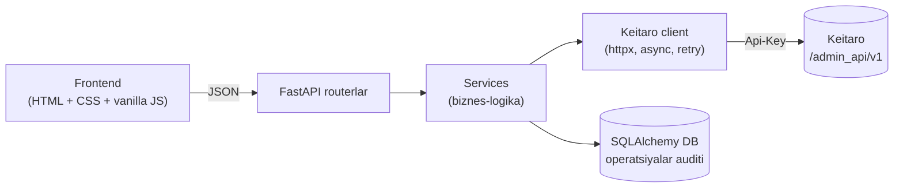

# Arxitektura: Adrobot — Keitaro ustidan o'ram (wrapper)

> 🇷🇺 По-русски: [ARCHITECTURE.ru.md](ARCHITECTURE.ru.md) · Holat: **amalga oshirilgan va testlar bilan qoplangan** (24 test, `pytest`).

## 1. Maqsad va chegaralar

Xizmat — Keitaro Admin API (v1) ustidagi yupqa o'ram. Ikki vazifa:

1. **Kampaniya yaratuvchi**: kirish — `name`, `geo` (davlat kodi), `offer_id`. Natija — Keitaro'da ikki oqimli kampaniya, domen, guruh va manba sozlangan.
2. **Kampaniya muharriri**: tanlangan kampaniyaning oqim/offerlarini ko'rish, offer qo'shish va o'chirish, to'g'ri ulushlar (%) va statistika.

Chegaradan tashqari: foydalanuvchi avtorizatsiyasi, offer/statistikani o'zimizda saqlash, reklama integratsiyalari.

## 2. Tamoyillar

| Tamoyil | Oqibat |
|---|---|
| **Keitaro — yagona haqiqat manbai** | Kampaniya/offer/statistikani o'z DB'mizda takrorlamaymiz. Hammasini API'dan o'qiymiz. |
| **O'z DB'miz — faqat audit** | Operatsiyalar tarixi jadvali (kim/nima/qachon/natija): nosozlikni topish va hisobot uchun. |
| **Yupqa qatlamlar** | `router → service → keitaro client`. Biznes-logika faqat `services`'da. |
| **Sirlar repodan tashqarida** | Kalit va URL faqat `.env`'dan; gitda `.env.example` turadi. |
| **Test ma'lumotlari xavfsizligi** | Har bir kampaniya `test_<familiya>_` prefiksi bilan boshlanishi shart (backend tekshiradi). |
| **Qisman xatolar hisobga olinadi** | Oqim yaratish yiqilsa, yaratilgan kampaniyani qaytarib o'chiramiz (arxivlaymiz). |

## 3. Umumiy sxema



## 4. Loyiha tuzilmasi

```
adrobot-keitaro/
├── app/
│   ├── main.py              # FastAPI, lifespan (mijoz/servislar app.state'da), statika
│   ├── config.py            # pydantic-settings, .env o'qish
│   ├── db.py                # engine, SessionLocal, Base
│   ├── models.py            # ORM: OperationLog
│   ├── schemas.py           # so'rov/javob Pydantic sxemalari
│   ├── errors.py            # domen xatolari + handlerlar (yagona xato formati)
│   ├── countries.py         # ISO-3166 davlat kodlari
│   ├── deps.py              # DI-bog'liqliklar (app.state)
│   ├── keitaro/
│   │   ├── client.py        # HTTP-klient: timeout, retry, xatolarni qayta ishlash
│   │   └── models.py        # Keitaro javoblari DTO'lari (Offer, Campaign, Stream, …)
│   ├── services/
│   │   ├── reference.py     # domen/guruh/manba nomi → ID (kesh)
│   │   ├── offers.py        # autocomplete uchun offerlar qidiruvi (TTL-kesh)
│   │   ├── report.py        # POST /report/build statistikasi
│   │   ├── audit.py         # operation_log'ga yozish
│   │   ├── campaign_creator.py
│   │   ├── campaign_editor.py
│   │   └── views.py         # Keitaro DTO → javob sxemasi
│   └── routers/
│       ├── meta.py          # /health, /api/meta
│       ├── offers.py
│       ├── campaigns.py
│       └── operations.py
├── alembic/                 # migratsiyalar (alembic upgrade head)
├── static/                  # index.html, styles.css, app.js, favicon.svg
├── tests/                   # pytest + respx (Keitaro mock)
├── scripts/
│   ├── dev.ps1              # venv + kutubxonalar + migratsiyalar + uvicorn
│   └── mock_keitaro.py      # Admin API v1 demo-emulyatori (xotirada)
├── docs/
├── .env.example
└── README.md / README.uz.md
```

## 5. Qatlamlar

- **Router** — kirishni tekshirish (Pydantic), servisni chaqirish, xatolarni HTTP kodlarga o'tkazish. Logika yo'q.
- **Service** — stsenariylar. *Nima* qilishni biladi, HTTP orqali *qanday* borishni bilmaydi.
- **Keitaro client** — URL, `Api-Key` sarlavhasi, timeout (15 s), 5xx/tarmoq xatolarida retry (2 urinish), javoblarni DTO'ga o'girish shu yerda yagona.
- **DB** — SQLAlchemy 2.x + Alembic. Standart SQLite, `DATABASE_URL` orqali PostgreSQL ulash mumkin.

## 6. Keitaro Admin API v1 kontrakti (solishtirilgan)

Kontrakt rasmiy Admin API v1 hujjati bilan solishtirilgan ([gist asabirov](https://gist.github.com/asabirov/3cd29f43de41bd76ab93de073a7883a9), asabirov — Keitaro ishlab chiqaruvchisi) va `app/keitaro/client.py`'da mustahkamlangan.

| Nima kerak | Chaqiruv |
|---|---|
| Domen (nomi bo'yicha) | `GET /domains` |
| Guruh (nomi bo'yicha) | `GET /groups?type=campaigns` |
| Manba (nomi bo'yicha) | `GET /traffic_sources` |
| Offer (ID bo'yicha) | `GET /offers/{id}` |
| Offerlar ro'yxati (autocomplete) | `GET /offers` (nom/ID bo'yicha filtr o'z tomonimizda, kesh 30 s) |
| Kampaniya yaratish | `POST /campaigns` — `name`, `alias` (generatsiya qilinadi), `type`, `state`, `domain_id`, `group_id`, `traffic_source_id`, `cost_type`, `cost_value`, `cost_currency`, `cost_auto` |
| Oqim yaratish | `POST /streams` — `campaign_id`, `type: regular`, `name`, `position`, `state`, `schema`, `action_type`, `action_payload`, `filters`, `offers` |
| Kampaniya oqimlari | `GET /campaigns/{id}/streams` |
| Oqim (ID bo'yicha) | `GET /streams/{id}` |
| Oqimni yangilash | `PUT /streams/{id}` (to'liq tana, offer bog'lanishlari `id` bilan) |
| Kampaniyani arxivlash (rollback) | `DELETE /campaigns/{id}` |
| Statistika | `POST /report/build` — `range {interval, timezone}`, `grouping [stream_id, offer_id]`, `metrics [clicks, stream_unique_clicks, bots, conversions, cr]`, `filters [campaign_id EQUALS …]` |

Avtorizatsiya: `Api-Key: <kalit>` sarlavhasi.

### Redirect-oqim (geо → Google)

`schema: "redirect"`, `action_type: "http"`, `action_payload: <REDIRECT_URL>`, filtr:

```json
{"filters": [{"name": "country_code", "mode": "allow", "payload": ["UZ"]}]}
```

### Offerlar oqimi (catch-all)

`schema: "offers"`, offer bog'lanishlari: `{"offers": [{"offer_id": 12, "share": 100}]}`.

## 7. A stsenariy — kampaniya yaratish

Kirish: `{ name, geo, offer_id }`.

1. Validatsiya: `name` `CAMPAIGN_PREFIX` bilan boshlanadi; `geo` — ISO-3166 bo'yicha 2 harf (katta harfga o'giriladi, ma'lumotnoma `app/countries.py`da); `offer_id` — butun son > 0.
2. Offer mavjudligini tekshirish (`GET /offers/{id}`), yo'q bo'lsa `404`.
3. `reference` `DEFAULT_DOMAIN`, `DEFAULT_GROUP`, `DEFAULT_SOURCE`'ni ID'ga aylantiradi (jarayon ishlaguncha kesh).
4. `POST /campaigns` (alias generatsiya qilinadi: transliteratsiya + tasodifiy qo'shimcha) → `campaign_id`.
5. **1-oqim (1-pozitsiya):** filtr «davlat — `geo`ni qabul qilish», amal — `REDIRECT_URL` (google.com)ga redirect.
6. **2-oqim (2-pozitsiya):** filtrsiz, «offerlar» sxemasi, bitta offer, ulushi 100%.
7. `operation_log`ga yozuv (muvaffaqiyat/xato).
8. **Rollback:** 5–6-qadam yiqilsa — kampaniya `DELETE` qilinadi (arxivlanadi), xato logga yoziladi.

Oqimlar tartibi muhim: Keitaro ularni yuqoridan pastga tekshiradi, shuning uchun «geо-oqim» birinchi, «catch-all» ikkinchi («Pozitsiya bo'yicha» rotatsiyada, `CAMPAIGN_TYPE=position`).

## 8. B stsenariy — kampaniya muharriri

**O'qish:** `GET /api/campaigns/{id}` → kampaniya + oqimlar + oqim offerlari (nomi, ulushi %, `POST /report/build`dan klik/unik/konversiyalar).

**Offer qo'shish** (`POST /api/campaigns/{id}/streams/{stream_id}/offers {offer_id}`):
1. Oqimni olish, sxemani tekshirish (`offers`) va offer u yerda yo'qligi (`409`).
2. Qo'shish va **ulushlarni qayta hisoblash**: yig'indi = 100%, teng taqsimlash, bo'lish qoldig'i — birinchi offerlarga (`distribute_shares`).
3. `PUT /streams/{id}` to'liq (mavjud bog'lanishlar — ularning `id`si bilan); yangilangan holatni qaytarish.

**Offer o'chirish** (`DELETE …/offers/{offer_id}`):
1. O'chirish, qolganlar orasida ulushlarni **qayta taqsimlash** (yig'indi = 100%).
2. «Offerlar» sxemali oqimdagi oxirgi offerni o'chirib bo'lmaydi → tushunarli xabar bilan `409`.

«To'g'ri raqamlar»: (a) offer ulushlari doim 100% beradi (testlar bilan tekshiriladi); (b) klik/unik/bot/konversiya/CR bevosita `report/build`dan olinadi (oqim va offer bo'yicha guruhlash); (c) davr va vaqt zonasi sozlanadi (`REPORT_INTERVAL`, `REPORT_TIMEZONE`).

## 9. Xizmat API'si

| Metod | Yo'l | Vazifa |
|---|---|---|
| GET | `/health` | tiriklik: Keitaro (`ok/unreachable/unconfigured`) va DB holati |
| GET | `/api/meta` | domen/guruh/manba/prefiks (UI'da ko'rsatish uchun) |
| GET | `/api/offers?q=` | offerlar autocomplete (nom yoki ID bo'yicha, kesh 30 s) |
| POST | `/api/campaigns` | kampaniya yaratish |
| GET | `/api/campaigns?prefix=&q=` | kampaniyalar ro'yxati (standart — bizning `test_…`) |
| GET | `/api/campaigns/{id}` | kampaniya, oqimlar, offerlar, statistika |
| POST | `/api/campaigns/{id}/streams/{sid}/offers` | offer qo'shish |
| DELETE | `/api/campaigns/{id}/streams/{sid}/offers/{oid}` | offer o'chirish |
| GET | `/api/operations?limit=` | operatsiyalar tarixi (audit) |

Yagona xato formati: `{ "error": { "code": "...", "message": "..." } }`.

## 10. Ma'lumotlar modeli (SQLAlchemy)

`operation_log`
| Maydon | Tur | Tavsif |
|---|---|---|
| id | int PK | |
| created_at | datetime | UTC |
| action | str | `create_campaign` / `add_offer` / `remove_offer` |
| keitaro_campaign_id | int, null | |
| campaign_name | str, null | tarixda qulaylik uchun |
| payload | JSON | kirish parametrlari |
| status | str | `ok` / `error` |
| error | text, null | xato matni |

Migratsiyalar — Alembic (`alembic upgrade head`), reviziya `0001`.

## 11. Xatolar va chidamlilik

| Holat | Reaksiya |
|---|---|
| Keitaro ochilmayapti / timeout / 5xx | retry, keyin `502 keitaro_unavailable` |
| Noto'g'ri kalit (401/403) | `502 keitaro_error` + logda aniq xabar (mijozga emas) |
| Offer/kampaniya/oqim topilmadi | `404 not_found` |
| Noto'g'ri geо/nom/oqim sxemasi | `422 validation` |
| Ziddiyat (offer allaqachon bor / oxirgi offer) | `409 conflict` |
| `report/build` hisoboti yiqildi | statistika = nollar, logga ogohlantirish (muharrir ishlashda davom etadi) |

## 12. Frontend

Bitta sahifa (HTML + vanilla JS, build'siz), FastAPI `static/`dan beradi. Qorong'u mavzu, uchta tab:

- **«Yangi kampaniya»** — ТЗ'dagi maket bo'yicha: Name (prefiks tekshiruvi bilan), Geo (ISO-kod tanlash + erkin kiritish), Offer (300 ms debounce bilan autocomplete), Create tugmasi; yaratilgach — ikki oqimli kampaniya kartasi va «Muharrirga o'tish» tugmasi.
- **«Kampaniya muharriri»** — kampaniya tanlash (prefiks/nom/ID bo'yicha qidiruv) → kampaniya kartasi (domen/guruh/manba, statistika tayllari) → oqim kartalari: filtr-chip'lar, vazifa, ulushli offerlar jadvali (progress-bar'lar), kliklar, uniklar, konversiyalar va CR; offer qo'shish (autocomplete) va o'chirish (tasdiqlash bilan), sahifani qayta yuklamasdan yangilanish, 4xx xatolar uchun toast'lar.
- **«Operatsiyalar tarixi»** — `operation_log` audit jadvali.

## 13. Test

- `pytest` + `respx` (Keitaro mock). Qoplangan: yaratish (happy path, validatsiya, arxivlash bilan rollback), qo'shish/o'chirish va ulushlarni qayta hisoblash, ziddiyatlar, offerlar qidiruvi kesh bilan, health/meta, utilitlar (`distribute_shares`, `generate_alias`).
- Demo-rejim: `python scripts/mock_keitaro.py` — Admin API v1 emulyatori xotirada (lokal ishlab chiqish va skrinkast uchun).
- Haqiqiy Keitaro'da `test_<familiya>_` prefiksi bilan qo'lda smoke-test.

## 14. Konfiguratsiya (`.env`)

`.env.example`ga qarang: `KEITARO_BASE_URL`, `KEITARO_API_KEY`, `KEITARO_TIMEOUT`, `KEITARO_RETRIES`, `CAMPAIGN_PREFIX`, `CAMPAIGN_TYPE`, `DEFAULT_DOMAIN`, `DEFAULT_GROUP`, `DEFAULT_SOURCE`, `REDIRECT_URL`, `REPORT_INTERVAL`, `REPORT_TIMEZONE`, `DATABASE_URL`, `OFFERS_CACHE_TTL`.

## 15. Holat

| Bosqich | Holat |
|---|---|
| API'ni hujjat bo'yicha solishtirish | ✅ kontrakt `app/keitaro/client.py`da mustahkamlangan |
| Skelet, config, Keitaro client | ✅ |
| Kampaniya yaratuvchi + rollback + testlar | ✅ |
| Muharrir: o'qish, add/remove, ulushlarni hisoblash, statistika | ✅ |
| Frontend, SQLAlchemy + Alembic, xatolarni qayta ishlash | ✅ |
| README (RU/UZ), demo-rejim, skrinkast | ✅ |

## 16. Yechilgan savollar

1. **Qo'shish/o'chirishda ulushlar** — har qanday o'zgarishdan keyin yig'indi = 100%, teng taqsimlash, qoldiq — birinchi offerlarga (test qilinadi).
2. **Keitaro API maydonlarining aniq nomlari** — 6-bo'limda va mijozda mustahkamlangan.
3. **Rollback** — kampaniya `DELETE /campaigns/{id}` orqali arxivlanadi (kalitning archive huquqi yetarli).

> Yagona xavf nuqtasi — mamlakat filtrining nomi `country_code` va `POST /campaigns`da `domain_id` qo'llab-quvvatlanishi Keitaro'ning aniq versiyasiga bog'liq: ikkala qiymat bitta joyda — `app/services/campaign_creator.py`da o'zgartiriladi.
